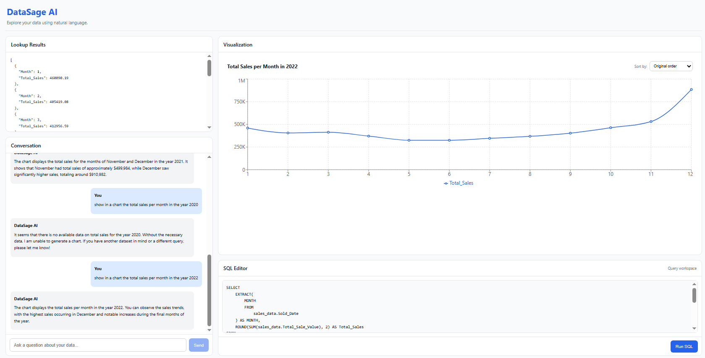
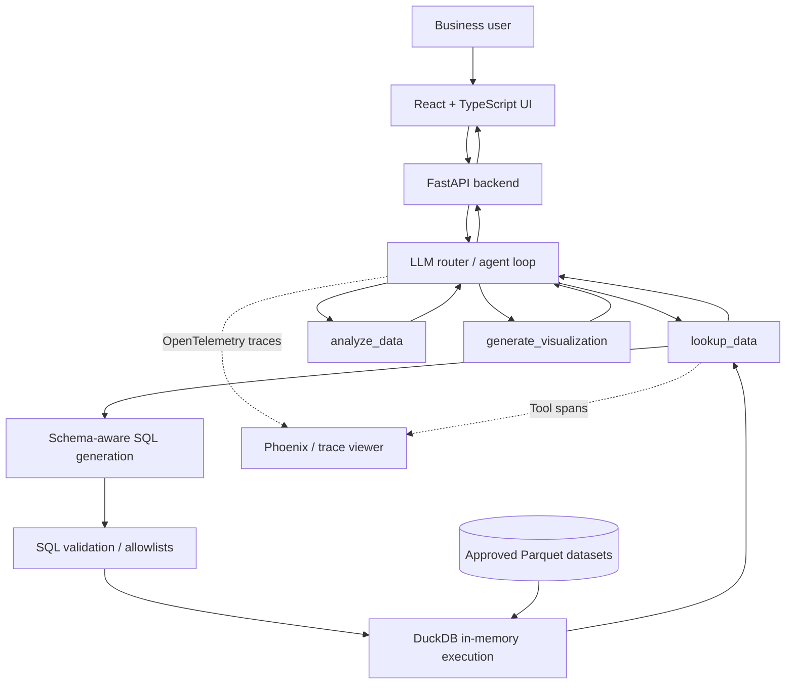
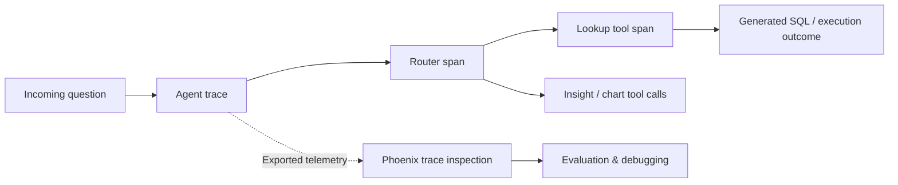
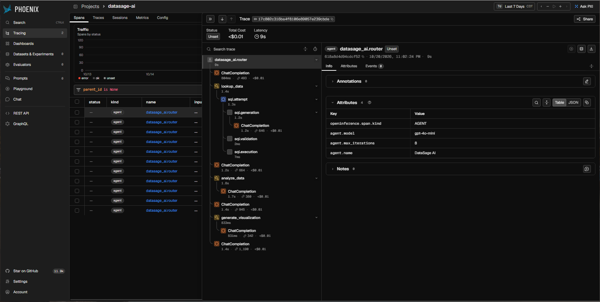
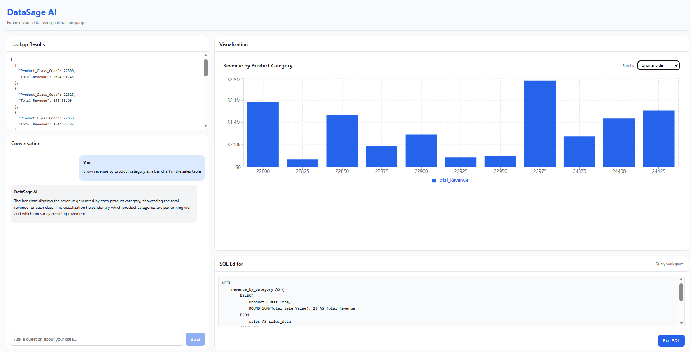

# DataSage AI

### A conversational analytics assistant that turns business questions into data queries, explanations, and visualizations

**Applied AI engineering · Agentic workflows · Natural-language analytics · Observability · Evaluation-driven development**

> **Portfolio project — documentation draft (v2).** The application source is maintained in a separate private repository. This edition includes real application and tracing screenshots. Demonstration video, live-demo link, measured evaluation results, and production deployment details remain pending.

*Application preview: conversational sales analytics with a 12-month visualization, lookup results, and an inspectable SQL editor.*
<!-- TODO: Add links: Live Demo | Video Walkthrough | Architecture | Technical Blog -->

## 1. Project overview

DataSage AI is an AI-powered analytics application designed to help users explore structured business data conversationally. Instead of manually writing SQL for every question, users ask in plain English. An AI agent interprets the intent, selects an appropriate tool workflow, accesses an approved Parquet dataset through DuckDB, and returns data-backed results, written insights, or chart specifications for the web interface.

The project is both a functional analytics prototype and an applied AI engineering case study: it demonstrates how to connect language models to deterministic tools, constrain generated SQL, expose execution traces, and evaluate routing and response quality.

**What it demonstrates:** moving beyond a single-prompt chatbot toward an observable, testable application with a frontend, API, agent orchestration, analytical tools, and safeguards.

## 2. Problem and motivation

Business users often know the questions they need answered but do not want to navigate schemas, compose SQL, or construct charts from scratch. Conventional self-service BI can still require technical knowledge and preparation. Meanwhile, an unconstrained AI chatbot may produce convincing claims without querying the actual data.

DataSage AI explores a middle ground: a conversational interface backed by executable, controlled data-access tools and verifiable query results. The design aims to reduce friction between asking a business question and understanding the underlying data, while keeping the SQL execution boundary explicit.

## 3. Core capabilities

| Capability | Experience | Technical mechanism |
|---|---|---|
| Natural-language analytics | Ask questions about available business data | Language-model-driven agent and tool selection |
| Data lookup | Retrieve figures and records in response to questions | Schema-aware SQL generation, DuckDB, Parquet |
| Business insights | Get explanations of returned data | `analyze_data` receives verified lookup output |
| Data visualization | Request a visual interpretation of results | `generate_visualization` returns a JSON chart specification for frontend rendering |
| Query transparency | Inspect the SQL generated for a lookup | Backend captures the validated query and exposes it in response state |
| Custom read-only queries | Run SQL against approved datasets | `execute_user_sql` with SQL parsing, allowlists, and result limits |
| Multi-turn conversations | Interact with an agent over a message history | Agent accepts prior messages and iterates over tool calls |
| Execution observability | Inspect agent and tool execution behavior | OpenTelemetry/OpenInference spans; Phoenix-oriented trace workflow |
| Quality evaluation | Assess tool decisions, outputs, and agent paths | Test suite, evaluation scripts, and evaluation labs |

**Demo dataset:** the portfolio version uses `sales.parquet`; other source data and development notebooks are excluded from the private repository snapshot discussed for publication.

## 4. User experience — how it works

1. **Open the application.** The user arrives at the React-based DataSage AI interface.
2. **Ask a business question.** Example: “What is the sales trend over time?” The exact fields and supported filters depend on the demo dataset's schema.
3. **The agent interprets intent.** A router selects an appropriate tool or sequence of tools based on the request.
4. **The system retrieves data.** For lookup requests, an LLM generates SQL using the registered dataset schema. The SQL is parsed and validated before DuckDB executes it.
5. **The system builds an answer.** The agent can summarize results or request a chart specification, using actual lookup results as its data source.
6. **Review the result.** The interface can present the conversational answer, underlying records, SQL query, and visualization where applicable.
7. **Continue exploring.** The user can ask follow-up questions or use the SQL capability when appropriate.

See the [real application screenshots](#13-screenshots-and-demonstration) below for an end-to-end sales example and product-category comparison.

## 5. System architecture

This diagram describes the application at a logical level, not its final hosting topology. In the implemented router, `analyze_data` and `generate_visualization` require a successful lookup first, and receive the stored lookup output rather than arbitrary model-supplied records.

### Component responsibilities

| Component | Responsibility |
|---|---|
| React / TypeScript frontend | Conversational user experience, result presentation, and chart rendering |
| FastAPI backend | HTTP-facing application boundary and response delivery |
| Agent router | Model-directed tool selection, message history, tool-call iteration, final response composition |
| `lookup_data` | Discover registered dataset schemas, generate SQL, validate and execute it, return records |
| `analyze_data` | Interpret results returned by lookup and generate readable insights |
| `generate_visualization` | Transform query records into a frontend-consumable chart specification |
| DuckDB | Lightweight analytical SQL execution against approved Parquet data |
| Parquet storage | Columnar demo data source |
| SQL validation (`sqlglot`) | Enforce read-only SQL structure, restricted functions, and approved table names |
| OpenTelemetry / OpenInference | Trace agent and tool execution with structured spans and attributes |
| Phoenix evaluation workflow | Examine traces and experiment with routing, component, and trajectory quality |
| Pytest / frontend tests | Verify selected application components and behavior |

## 6. Agent design and orchestration

DataSage AI follows a **router / supervisor-style tool orchestration pattern**. The model does not directly manipulate the dataset; it chooses among tool interfaces with well-defined responsibilities.

**Available tools**

- **`lookup_data(prompt)`**: turns a user request into a validated SQL lookup and returns JSON records.
- **`analyze_data(data, prompt)`**: analyzes verified records in the context of the user's question.
- **`generate_visualization(data, visualization_goal)`**: produces structured chart output from verified records.

The agent uses a bounded function-calling loop (configured with a default maximum of five model iterations). Tool failures are returned to the conversation as structured errors; the agent does not silently treat a failed lookup as valid data.

### Workflow examples

**A. Lookup:** User question → router → lookup tool → schema-aware SQL → validation → DuckDB → records → answer.

**B. Insight generation:** User asks “What stands out?” → router → lookup → analysis tool supplied with stored query records → explanation.

**C. Visualization:** User asks for a sales chart → router → lookup → visualization tool supplied with stored query records → JSON chart specification → frontend chart renderer.

**D. SQL inspection / editing:** User reviews the generated SQL and may submit a custom query through the dedicated read-only SQL execution path. This path enforces the approved dataset boundary and limits returned rows.

## 7. Safeguards, security, and reliability boundaries

The project implements several code-level controls to reduce risks associated with model-generated SQL:

- **Read-only SQL policy:** accepts one `SELECT` statement; rejects mutation and DDL statements, including `INSERT`, `UPDATE`, `DELETE`, `DROP`, `CREATE`, and `ALTER`.
- **Table and function restrictions:** generated SQL is parsed with `sqlglot` and checked against registered datasets and an allowed function set.
- **Restricted database access:** dataset tables are loaded first, after which DuckDB external access and automatic extension loading/installing are disabled.
- **Data provenance within agent flow:** analysis and visualization tools use the latest successful lookup result stored by the application, not untrusted free-form data supplied in model tool arguments.
- **Bounded retries and iterations:** SQL generation has up to three attempts; the agent loop has a configurable iteration ceiling.
- **Bounded custom SQL output:** manually executed SQL returns at most 200 records and reports truncation.
- **Secret separation:** credentials belong in environment configuration rather than public documentation or the repository.

**Limitations / next hardening steps:** these are application safeguards, not a claim of comprehensive production security. Public hosting should add authentication or abuse prevention, server-side query timeouts/resource limits, request rate limits, logging redaction, cost budgets, input-size limits, and production threat testing.

## 8. Observability and traceability

The application instruments the agent router and data lookup tool with **OpenTelemetry** spans and **OpenInference** attributes. The accompanying learning/evaluation notebooks demonstrate instrumentation of model calls and inspection of traces in **Arize Phoenix**.

Trace inspection helps answer engineering questions: Did the router pick the intended tool? Did SQL generation fail or retry? What data was passed to downstream tools? Where did the request spend time? Was the execution path appropriate?

*Phoenix tracing example: a selected agent run includes router, model, lookup, SQL-generation/validation/execution, analysis, and visualization spans. The screenshot reports approximately 9 seconds latency and a displayed estimated cost below $0.01 for this particular trace; these are not aggregate performance benchmarks. The selected agent attributes show a configured model of `gpt-4o-mini` for that run.*

Before publication, review every trace screenshot for identifiers or sensitive information and redact where appropriate.

## 9. Testing and evaluation strategy

A trustworthy analytical agent requires more than a successful demo. This project includes Python unit tests (covering routing, lookup, analysis, visualization, and API behavior), frontend test scaffolding, and dedicated evaluation scripts. The attached evaluation notebooks further explore:

| Evaluation layer | What it examines |
|---|---|
| Router evaluation | Did the agent select the appropriate tool/function? |
| Lookup / SQL evaluation | Was SQL generation correct for the requested analytical task? |
| Analysis evaluation | Were explanations clear and grounded in the query output? |
| Visualization evaluation | Was the chart-generation behavior appropriate to the question and data? |
| Trajectory evaluation | Did different versions of similar questions converge toward suitable execution paths? |
| Experiment-based evaluation | How did prompt variations affect responses against a test dataset? |
| Unit / API tests | Do components behave correctly in expected and failure cases? |

The notebooks use Phoenix experiments and LLM-as-a-judge approaches as *evaluation exercises*. **Published metric values, pass rates, and production benchmarks are intentionally omitted until they are measured against the current DataSage AI implementation.**

<!-- TODO: Add real eval table: test set, method, baseline, current result, date, limitations. -->

## 10. Applied AI engineering patterns

- **Tool-using AI agent:** language model selects functions rather than trying to answer every question from pretrained knowledge.
- **Router / supervisor orchestration:** central decision point chooses analytical capabilities and coordinates tool results.
- **Grounded response generation:** final insights and charts are based on data retrieved by the lookup tool.
- **Schema-aware text-to-SQL:** the model receives the registered dataset schema rather than guessing table names.
- **Deterministic enforcement after probabilistic generation:** SQL must pass explicit validation before execution.
- **Structured tool contracts:** tool inputs and outputs are typed/serialized, including JSON records and chart specifications.
- **Observability by design:** spans distinguish the router and tools, helping debug failures and trace behavior.
- **Evaluation-driven iteration:** router, tool, trajectory, and prompt assessments complement ordinary unit tests.
- **Human-in-the-loop opportunity:** users can inspect SQL and use a controlled custom-SQL route. A formal human approval workflow for every action is **not** asserted as implemented.

## 11. Engineering decisions and trade-offs

| Decision | Benefit | Trade-off / consideration |
|---|---|---|
| DuckDB + Parquet | Simple local analytics with minimal infrastructure | Not designed here as a concurrent, multi-tenant database service |
| Specialized tools | Clearer separation of responsibilities | More routing logic and tool-call overhead |
| LLM-generated SQL + parser validation | Natural-language flexibility with execution constraints | Valid SQL can still be logically wrong; requires evaluation |
| In-memory DuckDB | Reproducible demo execution | Repeated dataset loading and memory pressure for larger data |
| JSON chart specifications | Decouples generation from rendering | Charts still need schema validation and frontend handling |
| OpenTelemetry tracing | Diagnosability and experiment support | Trace data must be curated to avoid exposing sensitive inputs |
| Private source + public showcase | Portfolio visibility without opening implementation | Deployment requires a deliberate strategy for private build access |

## 12. Technology stack

**Frontend:** React, TypeScript, Vite, HTML/CSS, chart-rendering component.

**Backend / AI:** Python, FastAPI, OpenAI API / function calling, dedicated agent and prompt modules.

**Analytics / data:** DuckDB, Parquet, SQL, `sqlglot`.

**Observability / evaluation:** OpenTelemetry, OpenInference, Arize Phoenix evaluation workflow, Pytest, custom evaluation scripts.

**Engineering tools:** Git/GitHub, Python dependency tooling (`uv`), Node/npm.

## 13. Screenshots and demonstration

The following screenshots were captured from the DataSage AI development application. They demonstrate real interface behavior; they are **examples**, not evidence of production deployment or measured accuracy.

### Example A — Natural-language monthly sales analysis (2022)

**User request:** “show in a chart the total sales per month in the year 2022”

*Figure 1. A conversational request produces a monthly line chart alongside query results, the assistant's explanation, and generated SQL. All 12 months appear; sales dip during the middle of the year and peak in December.*

**What this illustrates:** schema-aware query generation, retrieval and grouping of data with DuckDB, text explanations, and frontend chart rendering. The screenshot displays month numbers rather than names; improved date-axis labeling is a UX enhancement for the roadmap.

### Example B — Revenue comparison across product categories

**User request:** “Show revenue by product category as a bar chart in the sales table”

*Figure 2. DataSage AI aggregates revenue by `Product_Class_Code` and produces a categorical bar chart, with lookup records, assistant response, and SQL editor visible. Product class 22975 is the largest displayed category at approximately $2.75M.*

**What this illustrates:** category-based aggregation, model-directed visualization, data-to-chart transformation, and query transparency. Current category labels are numeric codes and appear in original rather than descending revenue order; sorting and friendly display names are worthwhile UX refinements.

### Example C — Agent observability in Arize Phoenix

*Figure 3. The trace tree displays a router-coordinated workflow with LLM completions and tool spans, including SQL generation, validation, execution, analysis, and visualization. This single captured execution shows about 9 seconds latency, not an application-wide service-level metric.*

**What this illustrates:** execution transparency, tracing across agent/tool boundaries, and the ability to inspect duration and estimated cost for an individual request.

### Planned additions

- A short, narrated end-to-end video from prompt entry through SQL inspection and result visualization.
- A screenshot of the initial empty interface before a user query.
- A Phoenix evaluation experiment screenshot, with measured baseline and methodology (if publishable).
- Optional clearer chart labels and descending bar sort for the final showcase.

## 14. Deployment and public access — to be decided

The **showcase repository** should remain public and contain only project documentation, approved screenshots, architectural diagrams, and any explicitly intended public demo assets. The **application source repository** remains private.

A public portfolio repository does **not** itself need to contain private deployment code. The demo can be built and deployed from the private repository while the public README links to the hosted app.

Two deployment paths worth evaluating after documenting runtime requirements:

- **Railway / similar managed application platform:** convenient for a portfolio MVP, with straightforward backend/frontend service deployment; validate private repository build access, persistent files, memory needs, secret storage, and Phoenix hosting.
- **AWS:** greater control over networking, IAM, logs, compute and deployment architecture, but generally more operational setup. Evaluate a lightweight container-oriented approach before introducing unnecessary infrastructure.

**Decision pending:** hosting costs, dataset size, demo traffic, desired cloud architecture demonstration, observability hosting, and reliability requirements. No live environment is claimed yet.

## 15. Roadmap

**Next iteration**
- Add an end-to-end video walkthrough and an initial-screen screenshot (three current application/tracing screenshots are included).
- Validate demo prompts against the final `sales.parquet` schema.
- Publish sanitized example questions, SQL, responses, and charts.
- Run current automated tests and capture actual results.
- Produce a clean architecture graphic and Phoenix trace gallery.

**Deployment readiness**
- Select Railway or AWS based on architecture and budget.
- Protect API keys, add rate limiting and resource limits, validate CORS and frontend/backend configuration.
- Establish basic health checks, monitoring, usage/cost limits, and privacy-safe logging.
- Link the public documentation repository to the hosted demo.

**Future enhancements (proposals, not implemented features)**
- Clarification questions for ambiguous metrics and dimensions.
- Explicit approval workflow for expensive or sensitive queries.
- Dataset catalog and metadata management.
- More structured chart validation and insight quality checks.
- Repeatable regression benchmarks and CI evaluation gates.
- Production-ready authentication, roles, and multi-user data isolation.

## 16. Source code and project access

The source implementation is kept in a **private GitHub repository** (`datasage-ai-source`). This public repository is intended to serve as a technical case study and portfolio landing page, rather than a complete source distribution.

For a technical discussion, architecture review, or demonstration, contact the project author through the professional links below. Source access, if offered, is considered individually; no public source access is implied.

<!-- TODO: Insert author name, LinkedIn, blog, optional email or contact form, public repo URL, and live demo URL. -->

## 17. Project focus

DataSage AI demonstrates the integration of **AI orchestration, controlled analytical execution, responsive UI development, tracing, and evaluation** into a cohesive application. The central engineering lesson is that useful AI applications require more than model prompts: they require reliable tools, validated execution, observable workflows, tests, and a user experience that makes the outputs understandable.

---

*Status: initial public portfolio documentation draft; technical details should be reconciled with the final private source branch before publication.*
